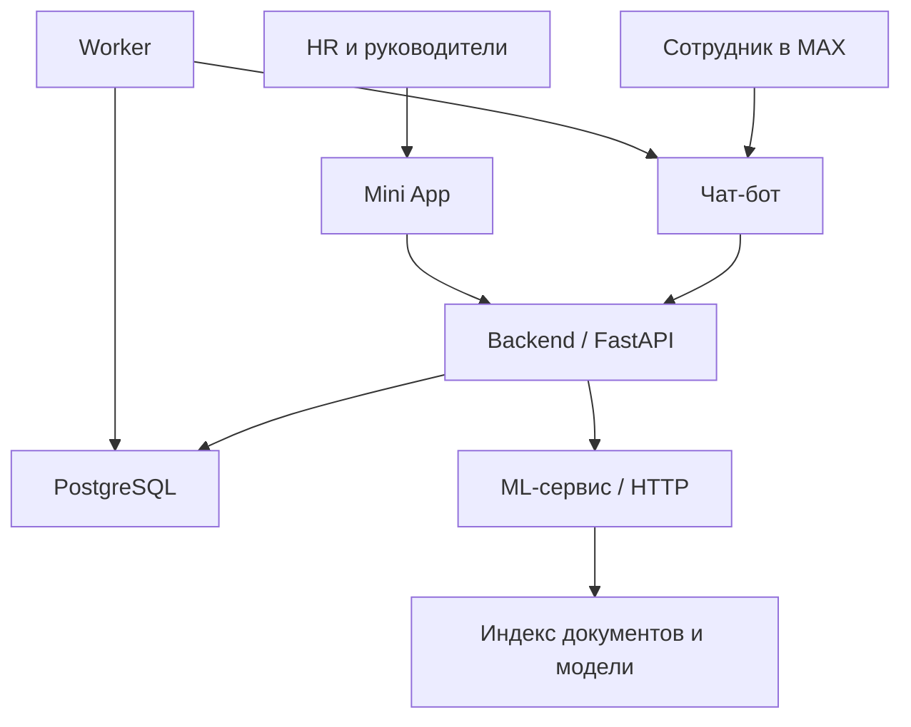
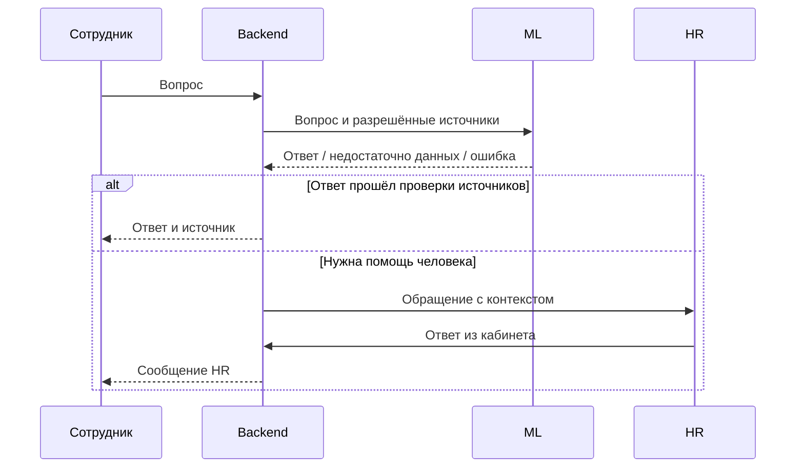

# Архитектура и решения

Схемы описывают взаимодействие компонентов и продуктовые решения. Конкретные маршруты и схемы данных находятся в исходном backend.

## Компоненты

Worker получает задания из БД; линия к боту обозначает доставку через транспорт MAX. База хранит бизнес-состояние, индекс ML — поисковые представления документов.

## От вопроса до человека

Недостаток знаний и техническая ошибка — разные причины. Их нужно различать в диагностике, даже если обе могут привести к обращению к HR.

## Решения и компромиссы

| Решение | Зачем | Ограничение |
|---|---|---|
| Один бот, области доступа по площадкам | Общая точка входа и единое обновление | Нужны проверки изоляции данных |
| Mini App для служебных ролей | Списки, формы и статусы удобнее длинных меню | Требуется поддержка веб-интерфейса |
| Отдельный ML-сервис | Разные зависимости и вычислительные ресурсы | Таймауты, контракты и обработка ошибок |
| PostgreSQL | Связи, транзакции, состояния процессов | Индексы и запросы требуют проверки |
| Задания в БД и worker | Меньше инфраструктуры для MVP | Масштабирование требует измерений |
| RAG с источниками | Использование изменяемых корпоративных документов | Источник не гарантирует смысловую корректность |

## Доступ

Учитываются роль, область ответственности и связи сотрудника. Физический компьютер не определяет полномочия. Проверки должны сохраняться при прямом API-запросе и при обращении к источникам RAG.

## Эксплуатационные ограничения

Нельзя выводить пропускную способность из количества зарегистрированных сотрудников. Обычные HTTP-операции и генерацию AI следует испытывать раздельно. Отдельный ML-сервис создаёт возможность независимого развития, но не доказывает горизонтальное масштабирование текущей реализации.
